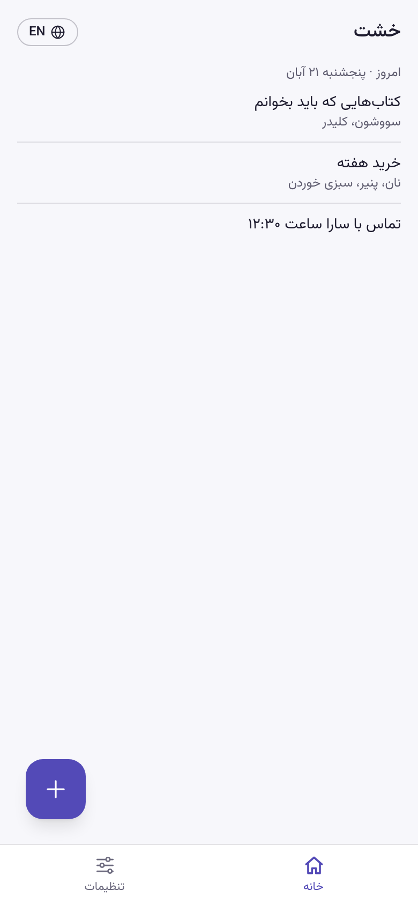
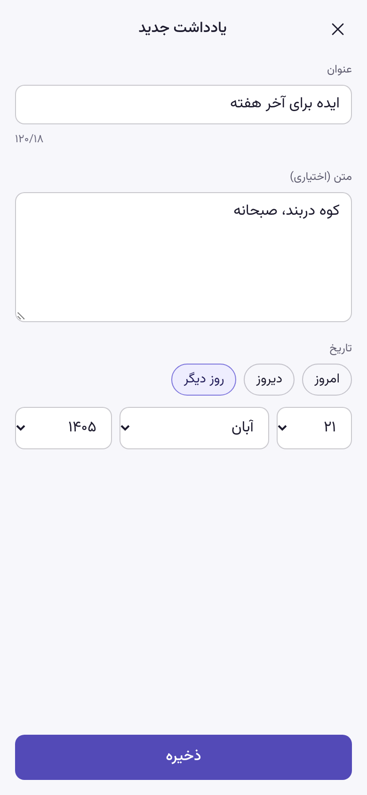
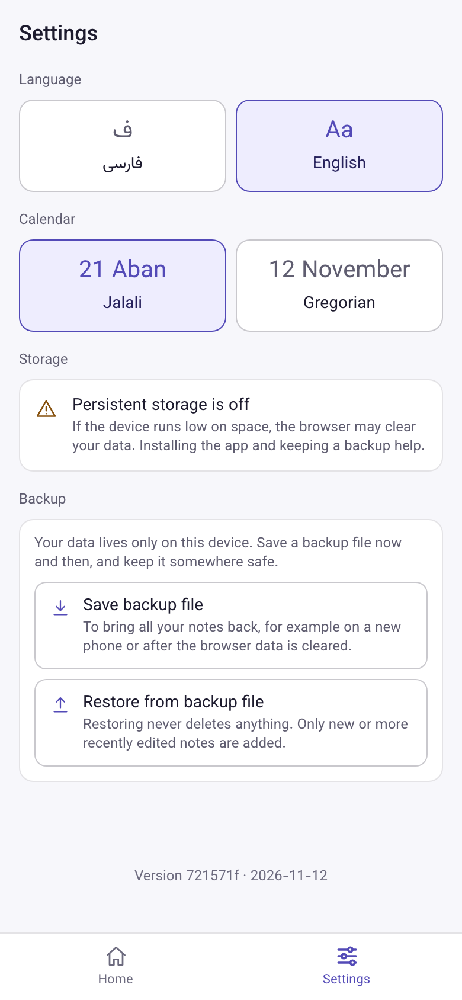

# Khesht · خشت

A starter template for offline-first, installable Persian web apps. Click **Use this template** and you get a working app that opens without internet, switches between Persian (right to left) and English (left to right), shows Jalali or Gregorian dates, stores data in IndexedDB, and backs it up to a file without ever losing anything. Tests, CI and deploy to GitHub Pages are already set up.

*Khesht* (خشت) is the sun-dried brick that old Persian houses were built from: the first brick of your app.

[](https://github.com/atefeh-sa93/khesht/actions/workflows/ci.yml)
[](https://github.com/atefeh-sa93/khesht/actions/workflows/deploy.yml)
[](LICENSE)

**Live demo:** https://atefeh-sa93.github.io/khesht/. Open it once, install it, then turn on airplane mode.

<p>
  
  
  
</p>

[فارسی](README.fa.md)

## What you get

- **Works fully offline.** After the first visit the whole app (HTML, JS, CSS, font, icons) comes from the cache. A new version waits until the user taps *Reload*, so a half-filled form is never wiped.
- **Installable.** A valid manifest (`lang: fa`, `dir: rtl`), icons generated from one SVG, and no installability errors in Chromium.
- **Persian and English, RTL and LTR.** Typed UI strings (a string missing in one language is a type error). The language is read before the first render, so the page never flashes in the wrong direction.
- **Jalali and Gregorian dates.** Dates are stored as ISO Gregorian strings (`2026-11-12`) and shown in the user's calendar: `پنجشنبه ۲۱ آبان ۱۴۰۵`, `Thu 12 November 2026`.
- **Numbers in the user's digits.** Parse what people type in Persian, Arabic or Latin digits; format with `۱۲٬۵۰۰` or `12,500`.
- **Numbers that keep their order in RTL text.** Two numbers joined by `/`, `:` or `,` merge into one left-to-right run and show reversed. `<Nums>` keeps each number in its own `<bdi>`, so `۹/۱۲۰` reads correctly. `isolateText()` does the same for plain strings.
- **IndexedDB with versioned migrations.** Dexie, a documented rule for schema changes, and a unit test that runs a real version 1 → 2 migration.
- **Backup that never deletes data.** The whole file is validated before anything is written; a bad file changes nothing. Restoring merges: new records are added, a record is replaced only by a newer copy.
- **Persistent storage.** Asked for once there is data worth keeping, with its status in Settings.
- **An example feature to replace.** A small notes list (add, edit, delete with undo, date picker) that shows how the pieces fit together, in one folder you can delete.
- **Tests and CI.** 139 unit tests (Vitest), 35 end-to-end tests (Playwright) against the production build, an axe accessibility audit of every screen in both languages, and GitHub Actions for CI and deploy.

## Use this template

1. Click **Use this template → Create a new repository**. Make it public if you want free GitHub Pages.
2. In your new repository: **Settings → Pages → Source: GitHub Actions**. The next push to `main` deploys to `https://<you>.github.io/<repo-name>/`; the deploy workflow takes the path from the repository name.
3. Edit **`app.config.ts`**, the one file with your app's identity:
   - `APP_ID`: short id used for storage keys, the database name and backup files. Change it before anyone has data.
   - `APP_NAME`, `APP_SHORT_NAME`, `APP_DESCRIPTION`, `THEME_COLOR`
   - `BASE_PATH`: set it to `/<repo-name>/` so local preview and E2E tests match the live site
   - `DEFAULT_CALENDAR`: `'jalali'` or `'gregorian'`
4. Replace **`public/icon.svg`** (512×512, artwork inside the central 80%) and run `pnpm generate-icons`. If you change the brand color, update it in `pwa-assets.config.ts` and in the color tokens at the top of `src/index.css`.
5. Rename the strings in `src/lib/i18n.ts` (`appName`, `tagline`) and replace this README.
6. Build your own feature, then remove the example (below).

### Removing the notes example

- Delete `src/features/notes/` and `tests/unit/noteStore.test.ts`, `tests/unit/groupByDay.test.ts`, `tests/e2e/notes.spec.ts`
- `src/app/routes.tsx`: the home, add and edit routes; `src/app/App.tsx`: the undo toast
- `src/app/navigation.ts`: the `add` and `edit` paths
- `src/db/schema.ts`: the `Note` type and the `notes` table (add your own tables there)
- `src/features/backup/`: `toNote` and the `notes` field (one of each per table you add)
- The note strings in `src/lib/i18n.ts`
- The E2E helpers and specs that add notes (`tests/e2e/helpers.ts`, `offline`, `backup`, `a11y`)

## Run it

You need Node 24 and pnpm (`corepack enable`).

```bash
pnpm install
pnpm dev            # http://localhost:5173, no service worker
pnpm build          # production build in dist/
pnpm preview        # the build at http://localhost:4173/khesht/, with the service worker
```

```bash
pnpm lint           # oxlint
pnpm typecheck      # tsc -b, app + config + E2E
pnpm test           # unit tests
pnpm test:e2e       # builds, serves and runs Playwright (Chromium)
```

The service worker only exists in the production build, so offline behavior is tested with `pnpm preview` and the E2E suite, not in `pnpm dev`. Playwright uses 2 workers by default to stay light on small laptops; pass `--workers=1` to go lighter, or run one spec: `pnpm test:e2e tests/e2e/notes.spec.ts`.

## How it is organized

```
app.config.ts        your app's id, names, colors, base path, default calendar
src/
  app/               shell: routes, navigation, header, bottom tabs, settings store
  db/schema.ts       Dexie database and every schema version
  features/
    notes/           the example feature (delete when you start)
    backup/          JSON export and validated, merging import
    settings/        settings page
  lib/               pure helpers: i18n, locale, Jalali dates, numbers, bidi
  pwa/               update prompt, offline badge, persistent storage
  ui/                Num / Nums and the local SVG icons
tests/
  unit/              Vitest, with fake-indexeddb
  e2e/               Playwright against the production build, plus the axe audit
```

## Decisions

- **Hash routes** (`#/settings`). GitHub Pages has no fallback to `index.html`, so `/khesht/settings` would 404 on reload; `/khesht/#/settings` always loads the app.
- **Update on the user's word.** `registerType: 'prompt'` instead of auto-update: a reload in the middle of typing loses work.
- **Settings in localStorage, data in IndexedDB.** Settings are read synchronously before the first render (no flash of the wrong direction); data needs indexes and transactions.
- **ISO Gregorian dates in storage.** They sort and filter as plain strings and any tool can read them. Jalali is display only.
- **Names of months written out, digits from `Intl`.** Browsers disagree on Persian month names and on the default calendar for `fa-IR`.
- **One `<bdi>` per number.** Only isolation keeps the order of neighbouring numbers right in both directions; `dir="ltr"` would break the English layout.
- **Restore merges, never deletes.** A backup file can be old. The newest copy of each record wins, and a file that fails validation is rejected as a whole.
- **Local SVG icons.** A dozen tiny icons in `src/ui/icons.tsx` are lighter than an icon library and follow the text color.

## Built from

Khesht is the generic core of [Daftar](https://github.com/atefeh-sa93/daftar), an offline expense tracker with Jalali dates and Toman amounts.

## License

[MIT](LICENSE) © 2026 Atefeh Atashi
